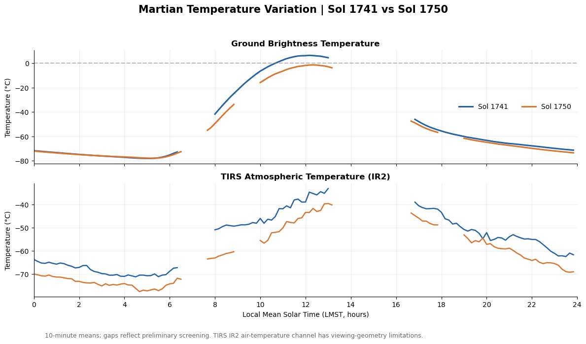
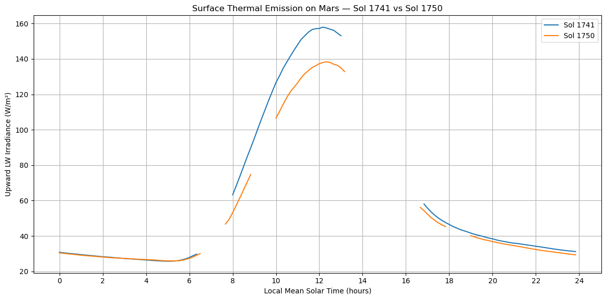

# Mars Perseverance MEDA–TIRS | Exploratory Thermal Data Analysis

**Independent undergraduate exploration · NASA Mars 2020 / Perseverance · Sol 1741 vs Sol 1750**

This repository documents an exploratory analysis of calibrated observations from the **Mars Environmental Dynamics Analyzer (MEDA) — Thermal Infrared Sensor (TIRS)** on NASA's Perseverance rover. It compares **ground brightness temperature**, the **TIRS IR2 atmospheric-temperature estimate**, **upward shortwave (SW) irradiance**, and **upward longwave (LW) irradiance** for two selected Martian sols.

**Start here:** [View the original Jupyter notebook](notebooks/01_initial_data_exploration.ipynb) · [Read the methods and limitations](docs/METHODS_AND_LIMITATIONS.md) · [Find the original NASA datasets](data/README.md)

> **Scientific status:** This is exploratory student work, **not a validated NASA analysis**. The notebook is the author's original `.ipynb`, including saved outputs. Its Python cells have passed a **syntax check** and the notebook format was validated, but the complete analysis **has not been rerun here** against the original NASA CSV/XML products. Some reported results are manually entered in notebook tables; see [review notes](docs/CODE_REVIEW_NOTES.md).

## Figures — in the intended six-image order

### 1 · Sol 1741 hourly temperature overview — illustrative

**An intuitive starting point, not the final screened result.** These earlier hourly air/ground temperature averages suggest an approximate day/night profile. The plot was created before the later preliminary flag-based exclusions, so its continuous curve must **not** be interpreted as fully quality-screened observations. The screened plot below is more appropriate for scientific comparison.

### 2 · Sol 1741 vs Sol 1750 — screened temperature comparison

**Why the gaps?** Observations were screened using four provisional rover/instrument-state flags, aggregated into 10-minute LMST bins, and bins with fewer than 300 retained observations were blanked. The breaks **preserve missing or screened-out intervals**; joining the segments would misleadingly imply continuous valid measurements. **Why is the IR2 temperature noisier?** Its retrieval channel has measurement and viewing-geometry limitations; the plots alone cannot establish whether the higher variability comes from instrument/retrieval effects or genuine atmospheric changes. TIRS IR2 estimates should not be confused with direct near-rover readings from MEDA's separate ATS.

### 3 · Upward shortwave irradiance

This is **upward SW irradiance (W/m²)** related to reflected solar radiation, not a direct albedo measurement. The observed daytime peaks and gaps should be interpreted alongside the retained measurement windows.

### 4 · Upward longwave irradiance

This shows **upward LW thermal infrared irradiance (W/m²)**, not temperature. The selected sols have different midday levels, but comparing only two sols cannot establish the physical reason.

### 5 · Selected peaks and midday values

Reported 10-minute peaks and midday averages. Peak timestamps are labeled **LTST (Local True Solar Time)**; the chart x-axes above use **LMST (Local Mean Solar Time)**. These values come from the author's supplied results; not all are recalculated automatically by the notebook's final table.

### 6 · Midday differences

Summarizes the reported **12:30–13:30 LTST** comparison. Each difference is **Sol 1750 minus Sol 1741**. The numerical summary below is descriptive, not a statement about long-term climatic trends.

## Selected findings (reported)

| Quantity | Sol 1741 | Sol 1750 |
|---|---:|---:|
| Peak 10-minute mean upward SW irradiance | 76.67 W/m² | 73.36 W/m² |
| Peak 10-minute mean ground brightness temperature | 6.53 °C | −1.32 °C |
| Midday mean upward SW irradiance | 76.14 W/m² | 72.56 W/m² |
| Midday mean upward LW irradiance | 157.06 W/m² | 137.54 W/m² |
| Midday mean ground brightness temperature | 6.18 °C | −1.66 °C |

The author's saved notebook output reports these midday means. The peak-value summary includes values entered as literal strings; the full figure/table pipeline remains to be independently reproduced from the original products.

## What's in this repository?

| Location | Purpose |
|---|---|
| [`notebooks/01_initial_data_exploration.ipynb`](notebooks/01_initial_data_exploration.ipynb) | **Original Jupyter notebook**, 44 cells (code, explanatory Markdown, and saved outputs) |
| [`figures/`](figures/) | Six final presentation images, numbered **01–06** in the chosen order |
| [`data/README.md`](data/README.md) | NASA PDS source references and exact filenames expected by the notebook |
| [`docs/METHODS_AND_LIMITATIONS.md`](docs/METHODS_AND_LIMITATIONS.md) | Methodology, preliminary filtering, interpretation, and limitations |
| [`docs/CODE_REVIEW_NOTES.md`](docs/CODE_REVIEW_NOTES.md) | Unresolved reproducibility checks, without changing the author's code |
| [`requirements.txt`](requirements.txt) | Python package list, not yet version-pinned or environment-tested |
| [`CONTRIBUTING.md`](CONTRIBUTING.md) | Suggestions for anyone interested in extending the project |

## How to explore or rerun the notebook

1. Download the original **calibrated MEDA–TIRS** CSV files for **Sol 1741** and **Sol 1750** and keep their corresponding **XML labels**. See [data/README.md](data/README.md). The source products are **not redistributed here**.
2. Create the local folder `data/raw/` and put the two CSV files there, with these exact expected names:
   - `WE__1741___________CAL_TIRS________________P01.csv`
   - `WE__1750___________CAL_TIRS________________P01.csv`
3. Install Python and the dependencies listed in [`requirements.txt`](requirements.txt), or use an existing Anaconda environment with NumPy, pandas, Matplotlib, and a Jupyter kernel.
4. Open [`notebooks/01_initial_data_exploration.ipynb`](notebooks/01_initial_data_exploration.ipynb) in **VS Code (Jupyter extension)** or Jupyter Notebook. Make sure the notebook's **current working directory is `notebooks/`** so the existing paths `../data/raw/...` resolve correctly.
5. Run cells in order and compare computed outputs with the six published images. Review [known limitations](docs/CODE_REVIEW_NOTES.md) first; the notebook contains exploratory cells and is **not a fully verified, automated reproduction pipeline**.

**Notes:** The initial Sol 1741 hourly plot predates the quality screen. The subsequent screen requires all four flags `ROVER_LOW_TILT`, `ROVER_STILL`, `TIRS_GROUND_FOOTPRINT_NOT_IN_SHADOW`, and `SUN_OUTSIDE_TIRS_FOV` to equal 1, followed by a minimum of **300 retained observations** per 10-minute bin. These are **preliminary criteria**, not an independently verified complete MEDA/TIRS validity assessment. Time-of-day charts use **LMST**; peak/midday summaries refer to **LTST**.

## Data credit, transparency, and scope

**Source:** NASA Planetary Data System (PDS), *Mars 2020 Perseverance MEDA calibrated TIRS products*. [NASA PDS MEDA archive](https://pdsatmospheres.nmsu.edu/data_and_services/atmospheres_data/PERSEVERANCE/meda.html) · [MEDA dataset DOI](https://doi.org/10.17189/1522849). The associated PDS XML metadata and reference documents, including the **MEDA RDR SIS**, should be consulted when interpreting measured fields and quality limitations.

This is an **independent educational analysis**, not an official NASA publication or endorsement. **AI assistance:** ChatGPT supported code development and repository documentation; the project author selected the scientific questions, analysis workflow, figures, and interpretations. Numerical results and physical conclusions require independent validation before research use.

Readers interested in extending the work can see [CONTRIBUTING.md](CONTRIBUTING.md).
