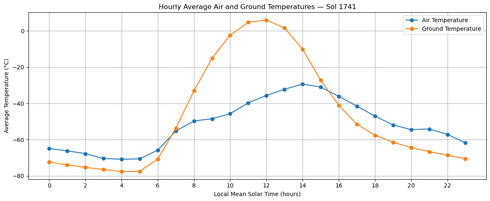
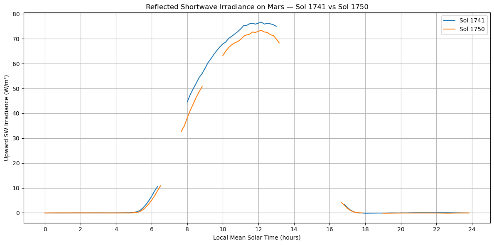
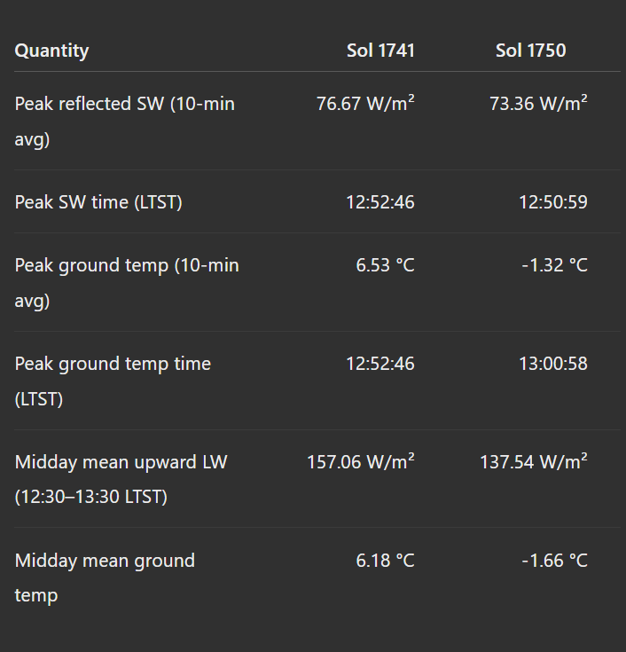
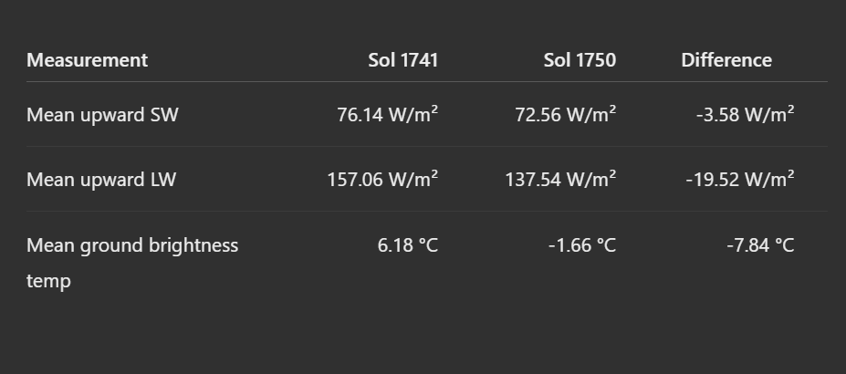

# Mars Perseverance MEDA–TIRS | Exploratory Thermal Data Analysis

**Independent student project · Mechanical engineering / planetary data analysis · Sol 1741 vs Sol 1750**

This repository presents an exploratory comparison of NASA Perseverance rover **MEDA Thermal Infrared Sensor (TIRS)** calibrated observations. The project investigates the diurnal behavior of **ground brightness temperature, IR2-derived atmospheric temperature, upward shortwave irradiance, and upward longwave irradiance**, with an emphasis on **data quality and honest visualization**.

> **Status:** This repository includes the six supplied figures and the author's original Python exploration script (with VS Code `# %%` cell markers). The script has passed a **Python syntax check**, but its outputs **have not been independently rerun or verified against the original NASA CSV/XML files here**. The summary tables include manually entered values; see [code review notes](docs/CODE_REVIEW_NOTES.md) before using the numerical findings as independently validated results.

## Figures — intended presentation order

### 1. Full-day Sol 1741 temperature overview (illustrative)



This earlier **hourly-average** chart gives newcomers a sense of the approximate day/night trend. **It is not a fully quality-screened plot** and should not be interpreted as an uninterrupted record of reliable measurements. The screened comparison below is preferable for scientific interpretation.

### 2. Sol 1741 vs Sol 1750: screened temperature comparison


The displayed 10-minute mean curves compare **ground brightness temperature** and the **TIRS IR2 atmospheric-temperature estimate**. Breaks are deliberately left where observations have been excluded by the project's **preliminary screening**; connecting points across gaps could create a misleading impression of continuous reliable data. The IR2 curve is more variable; potential contributors include channel/retrieval physics, uncertainties, viewing geometry, and real variation. **The figure alone cannot establish a single cause of the noise.** Do not equate the IR2-derived estimate automatically with a direct measurement from the separate MEDA ATS instrument.

### 3. Reflected shortwave irradiance



The upward-looking shortwave measurement relates to **reflected sunlight**, with higher daytime values in the observed windows. Incomplete intervals and screening remain visible as gaps. The plot shows irradiance (W/m²), **not** a direct surface albedo estimate.

### 4. Upward longwave thermal irradiance


This shows the measured **upward thermal infrared irradiance** (W/m²), not temperature. Both selected sols exhibit a daytime increase in the displayed windows, with different midday amplitudes. A two-sol difference by itself does not prove a specific physical cause.

### 5. Peaks and midday summary



Selected reported **10-minute peaks**, their times in **LTST**, and midday averages. The values are transcribed from the author's table and are not independently recomputed in this version.

### 6. Midday comparison table



Differences follow the convention **Sol 1750 minus Sol 1741** for the supplied summary window. See [Methods and limitations](docs/METHODS_AND_LIMITATIONS.md) for units, numbers, cautions, and data coverage.

## Selected descriptive findings

| Reported statistic | Sol 1741 | Sol 1750 |
|---|---:|---:|
| Peak 10-minute upward SW irradiance | 76.67 W/m² | 73.36 W/m² |
| Peak 10-minute ground brightness temperature | 6.53 °C | −1.32 °C |
| Midday mean upward SW irradiance | 76.14 W/m² | 72.56 W/m² |
| Midday mean upward LW irradiance | 157.06 W/m² | 137.54 W/m² |
| Midday mean ground brightness temperature | 6.18 °C | −1.66 °C |

These comparisons concern **two selected sols, not a trend across the mission**. The reported values are transcribed from the provided figures. The original script now documents the preliminary flag selection and time-window calculations, but the results still require a full rerun against the NASA source files and a numerical cross-check.

## Data source and methods

The source consists of NASA Planetary Data System (PDS) **Mars 2020 MEDA calibrated TIRS CSV files and matching XML metadata** for the selected sols. For access and provenance see [data/README.md](data/README.md).

The work entails interpreting the time columns (LMST and LTST), converting temperature units, applying quality-related screening, constructing time-averaged plots, and comparing selected summaries. The [original Python script](notebooks/Perseverance_TIRS_data_exploration.py) records a **first-pass four-flag screen** (rover low tilt, rover still, ground footprint not in shadow, and Sun outside the TIRS field of view) and requires **at least 300 observed samples per 10-minute LMST bin**. These are the author's provisional choices, **not automatically a complete instrument validity assessment**. See [notebook instructions](notebooks/README.md) and [code review notes](docs/CODE_REVIEW_NOTES.md).

**Time bases:** figure horizontal axes use **LMST**; reported peak times and the summary midday window use **LTST**. These are distinct clocks. See [Methods and limitations](docs/METHODS_AND_LIMITATIONS.md).

## Running the original exploration script

1. Download the original calibrated CSV files and corresponding PDS4 XML labels for Sol 1741 and Sol 1750; consult [data/README.md](data/README.md).
2. Save the CSV files in `data/raw/` with **exactly** the filenames used in the script: `WE__1741___________CAL_TIRS________________P01.csv` and `WE__1750___________CAL_TIRS________________P01.csv`. The companion XML files are important for reading field definitions and the quality metadata; the script currently reads only the CSVs.
3. Install the **declared minimum** dependencies: `python -m pip install -r requirements.txt`. Version pinning and execution on a clean environment are **not yet verified**.
4. Run **from the `notebooks` directory**, because the original script uses `../data/raw/` relative file paths:

   ```bash
   cd notebooks
   python Perseverance_TIRS_data_exploration.py
   ```

The script retains sequential learning/exploration cells and interactive figures; it is **not a packaged, automatically verified pipeline**, and the final two summary tables are **not fully generated programmatically**. Execution may display multiple plots and write `Mars_Temperature_Comparison.png` to the working directory. Review [known code issues](docs/CODE_REVIEW_NOTES.md) before relying on the output. For VS Code's interactive-cell execution, ensure the current working directory resolves `../data/raw/` correctly.

## Credits and transparency

Data credit: **NASA/JPL-Caltech and the Mars 2020 MEDA instrument team**, via the NASA Planetary Data System. This is **independent educational analysis**, not an official NASA publication or validated scientific result.

**AI assistance:** ChatGPT assisted with coding and documentation; the project author directed the analysis goals, workflow, interpretation, and presentation. Source-code correctness and physical conclusions require review and reproducibility checks.

## More information

- [Detailed methods, numerical summary and limitations](docs/METHODS_AND_LIMITATIONS.md)
- [Source data / provenance](data/README.md)
- [How to run the original Python exploration script](notebooks/README.md)
- [Code review and outstanding checks](docs/CODE_REVIEW_NOTES.md)
- [How to contribute](CONTRIBUTING.md)
